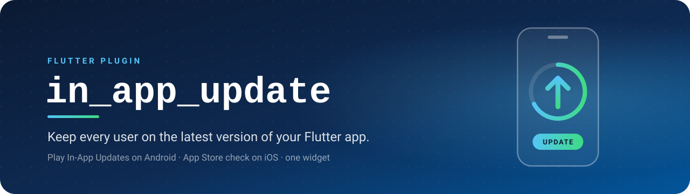
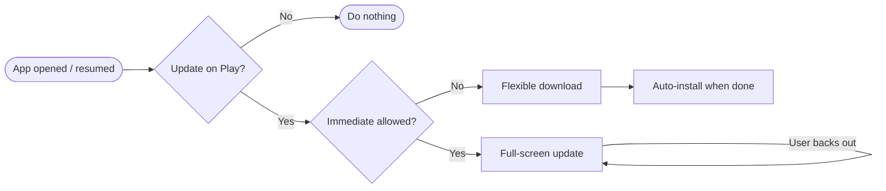

<div align="center">



<br />
<br />

<p>
  
  
  
  
</p>

<p>
  <a href="#-features"><b>Features</b></a>
  &nbsp;·&nbsp;
  <a href="#-quick-start"><b>Quick start</b></a>
  &nbsp;·&nbsp;
  <a href="#-api-reference"><b>API</b></a>
  &nbsp;·&nbsp;
  <a href="example/"><b>Example</b></a>
</p>

</div>

---

A small, typed wrapper around the [Google Play In-App Updates API](https://developer.android.com/guide/playcore/in-app-updates) (Play Core `app-update` 2.1.0) on Android, and an App Store version check on iOS. Wrap your app in **one widget** and users are prompted to update whenever a newer version is available — with Play's full-screen update screen on Android, and with your app's App Store page, shown inside the app, on iOS.

```dart
InAppUpdateScope(child: MyApp()) // that's it ✨
```

## ✨ Features

- 🔒 **Mandatory by default** — shows the update screen on app open and on every return to the foreground, and again if the user backs out.
- 🌙 **Flexible updates** — downloads in the background while the app keeps running, with progress, so you can show your own *"Restart to update"* prompt.
- 🧱 **One widget** — `InAppUpdateScope` handles checking, prompting, resuming interrupted updates and installing. `InAppUpdateController` if you want to own the state.
- 🍎 **iOS too** — checks the App Store for a newer version and shows the App Store page inside your app. No extra setup, no API keys.
- 🧩 **Imperative API** — `InAppUpdate.checkForUpdate`, `startUpdate`, `completeUpdate` and `installStateChanges`.
- 🌐 **Safe everywhere** — web and desktop report `unsupported`, so the same code runs on every platform.

## 📋 Requirements

| | Requirement |
| :-- | :-- |
| 🐦 **Flutter** | 3.24+ (Dart 3.5+) |
| 🤖 **Android** | `minSdk` 24+ · app **installed from Google Play** |
| 🍎 **iOS** | 15.0+ · app **live on the App Store** |

## 📦 Installation

```yaml
dependencies:
  in_app_update:
    git: https://github.com/nameisjayant/flutter_in_app_update
```

> [!NOTE]
> There are no extra setup steps on either platform. The plugin brings the Play Core dependency on Android and links StoreKit on iOS. Both CocoaPods and Swift Package Manager are supported.

## 🚀 Quick start

Wrap your app once, at the root:

```dart
import 'package:flutter/foundation.dart';
import 'package:in_app_update/in_app_update.dart';

void main() {
  runApp(
    const InAppUpdateScope(
      enabled: kReleaseMode,
      child: MyApp(),
    ),
  );
}
```

That's all you need. When a new version is on Play or the App Store, users see the update screen and can't continue until they update. 🎉

> [!TIP]
> `enabled: kReleaseMode` turns updates off in debug builds. Builds installed from `flutter run` aren't from Play, so they can't receive updates.

## 📖 Usage

### 🔒 Mandatory update (default)

```dart
InAppUpdateScope(child: MyApp()) // same as mandatory: true
```



How it behaves on Android:

| Situation | Behaviour |
| :-- | :-- |
| App opened or resumed, update available | Shows Play's full-screen **immediate** update |
| User backs out of the update screen | Shows it again right away (or on next resume) |
| Immediate update was interrupted | Resumes it |
| Play doesn't allow an immediate update | Downloads it as a flexible update and installs it automatically when done |
| Flexible update downloaded in an earlier session | Installs it on launch |
| No update, or app not installed from Play | Does nothing (`status` is `upToDate` or `error`) |

On iOS, see [🍎 iOS](#-ios).

### 🌙 Flexible update

Let users keep using the app while the update downloads, then ask them to restart. Anything below the scope can read its state with `InAppUpdateScope.of(context)`, and rebuilds when it changes:

```dart
InAppUpdateScope(mandatory: false, child: MyApp())

class UpdateBanner extends StatelessWidget {
  const UpdateBanner({super.key});

  @override
  Widget build(BuildContext context) {
    final update = InAppUpdateScope.of(context);
    return switch (update.status) {
      UpdateStatus.downloading =>
        Text('Downloading update… ${(update.progress * 100).round()}%'),
      UpdateStatus.downloaded => TextButton(
          onPressed: update.completeUpdate, // installs and restarts the app
          child: const Text('Restart to update'),
        ),
      _ => const SizedBox.shrink(),
    };
  }
}
```

### 🎛️ Your own controller

`InAppUpdateController` is a `ChangeNotifier`, so it works with `ListenableBuilder`, Provider, Riverpod and friends. Give it to the scope, or call `start()` / `dispose()` yourself:

```dart
final updates = InAppUpdateController(mandatory: false)..start();

ListenableBuilder(
  listenable: updates,
  builder: (context, _) => Text(updates.status.name),
);
```

### 🧩 Imperative API

Use these when you want to decide yourself when and how to update — for example, only for high-priority releases:

```dart
final info = await InAppUpdate.checkForUpdate();

if (info.updateAvailability == UpdateAvailability.available &&
    info.updatePriority >= 4 &&
    info.isImmediateAllowed) {
  final result = await InAppUpdate.startUpdate(UpdateType.immediate);
  // UpdateFlowResult.accepted | canceled | failed
}

// Track a flexible download
final sub = InAppUpdate.installStateChanges.listen((state) {
  print('${state.installStatus} ${state.bytesDownloaded}/${state.totalBytesToDownload}');
  if (state.installStatus == InstallStatus.downloaded) InAppUpdate.completeUpdate();
});

// later
await sub.cancel();
```

Failures throw `InAppUpdateException`, with a `code` such as `InAppUpdateException.checkFailed` or `notAvailable`.

### 🍎 iOS

iOS has no equivalent of Play's in-app updates, so the plugin does what most iOS apps do:

1. **Check** — `checkForUpdate()` looks up your bundle ID with Apple's public [iTunes Lookup API](https://performance-partners.apple.com/search-api) and compares the App Store `version` with your app's `CFBundleShortVersionString`. It uses the store for the device's region, then falls back to the US store.
2. **Prompt** — `startUpdate()` shows your app's App Store page **inside the app** (`SKStoreProductViewController`). The user taps *Update* there. If the sheet can't load, it opens the App Store app instead.

The same widget works unchanged:

| Situation | `mandatory: true` (default) | `mandatory: false` |
| :-- | :-- | :-- |
| Update available on app open/resume | Shows the App Store page | Shows the App Store page |
| User closes the page | Shows it again right away | `status` becomes `canceled`, app continues |
| User taps *Update* | iOS installs it and relaunches the app on the new version | Same |
| Device's iOS is older than the new version's minimum | Treated as no update | Same |

> [!IMPORTANT]
> **Differences from Android**
> - `availableVersion` (e.g. `"2.1.0"`) and `releaseNotes` (the "What's New" text) are filled in. `availableVersionCode` and `updatePriority` are always `0`.
> - `clientVersionStalenessDays` is the number of days since the App Store version was released, so you can force an update only after a grace period.
> - `startUpdate()` always completes with `canceled` once the App Store page closes. Apple doesn't tell apps whether the user updated. If they did, iOS relaunches the app on the new version.
> - `UpdateType`, `completeUpdate()` and `installStateChanges` don't apply. They're accepted and do nothing.
> - Apple's lookup can lag a few hours behind a new release, so not every user sees the update the moment it goes live.

## 📚 API reference

### `InAppUpdateScope`

| Parameter | Type | Default | Description |
| :-- | :-- | :-- | :-- |
| `child` | `Widget` | — | Your app |
| `mandatory` | `bool` | `true` | Force the update: immediate flow (App Store page on iOS), shown again on cancel, flexible downloads installed automatically |
| `type` | `UpdateType` | `flexible` | Android flow to use when `mandatory` is `false` (ignored on iOS) |
| `checkOnResume` | `bool` | `true` | Check again whenever the app returns to the foreground |
| `enabled` | `bool` | `true` | Turn updates off entirely (e.g. `kReleaseMode`) |
| `onError` | `void Function(InAppUpdateException)?` | — | Called with any Play or App Store error |
| `controller` | `InAppUpdateController?` | — | Use your own controller; the options above are then read from it |

`InAppUpdateScope.of(context)` returns the controller; `maybeOf` returns `null` outside a scope.

### `InAppUpdateController`

Takes the same options as the scope, plus `checkOnStart` (default `true`).

| Member | Type | Description |
| :-- | :-- | :-- |
| `status` | `UpdateStatus` | Current state of the update flow (see below) |
| `updateInfo` | `UpdateInfo?` | Result of the last check |
| `error` | `InAppUpdateException?` | Last error, if any |
| `progress` | `double` | Download progress of a flexible update, `0`–`1` |
| `start()` / `stop()` | `void` | Start or stop checking on resume and listening for downloads |
| `checkNow()` | `Future<void>` | Run the check → update flow right now |
| `completeUpdate()` | `Future<void>` | Install a downloaded flexible update (restarts the app) |

#### `UpdateStatus`

| Value | Meaning |
| :-- | :-- |
| ⚪ `idle` | Nothing has happened yet |
| 🔍 `checking` | Asking Play or the App Store for updates |
| ✅ `upToDate` | No update available |
| 📲 `prompting` | The Play update screen or App Store page is showing |
| ↩️ `canceled` | User dismissed the update screen (shown again when `mandatory`) |
| ⬇️ `downloading` | Flexible update is downloading |
| 📦 `downloaded` | Flexible update is ready; call `completeUpdate()` |
| ⚙️ `installing` | Update is being installed |
| 🚫 `unsupported` | Platform has no in-app updates (web, desktop) |
| ❌ `error` | Something failed (see `error`) |

### `InAppUpdate`

| Member | Returns | Description |
| :-- | :-- | :-- |
| `checkForUpdate()` | `Future<UpdateInfo>` | Asks Google Play or the App Store whether a newer version is available |
| `startUpdate([type = immediate])` | `Future<UpdateFlowResult>` | Shows the Play update UI, or the App Store page on iOS. Throws if no update can be started (and always on unsupported platforms) |
| `completeUpdate()` | `Future<void>` | Installs a downloaded flexible update. The app restarts. No-op on iOS |
| `installStateChanges` | `Stream<InstallState>` | Download/install progress. Never emits on iOS |

<details>
<summary><b>Show all types</b></summary>

```dart
enum UpdateType { immediate, flexible }

enum UpdateFlowResult { accepted, canceled, failed } // always canceled on iOS

enum UpdateAvailability { unknown, notAvailable, available, inProgress, unsupported }

enum InstallStatus {
  unknown, pending, downloading, downloaded,
  installing, installed, failed, canceled, requiresUiIntent,
}

class UpdateInfo {
  UpdateAvailability updateAvailability;
  InstallStatus installStatus;
  int availableVersionCode;        // Play versionCode, 0 on iOS
  String? availableVersion;        // App Store version, null on Android
  String? releaseNotes;            // App Store "What's New", null on Android
  bool isImmediateAllowed;
  bool isFlexibleAllowed;
  int? clientVersionStalenessDays; // days since Play learned about / App Store released the update
  int updatePriority;              // 0–5, set via the Play Developer API, 0 on iOS
  int bytesDownloaded;
  int totalBytesToDownload;
}

class InstallState {
  InstallStatus installStatus;
  int installErrorCode;            // Play InstallErrorCode, 0 = no error
  int bytesDownloaded;
  int totalBytesToDownload;
}

class InAppUpdateException implements Exception {
  String code;                     // E_CHECK_FAILED, E_NOT_AVAILABLE, E_START_FAILED, …
  String message;
}
```

</details>

## 🌐 Platform support

| Platform | Support | Behaviour |
| :-- | :--: | :-- |
| 🤖 **Android** | ✅ | Full support via Google Play In-App Updates |
| 🍎 **iOS** | ✅ | App Store version check + in-app App Store page (see [iOS](#-ios)) |
| 🌐 **Web, desktop** | ➖ | No-op. `checkForUpdate()` returns `UpdateAvailability.unsupported`, the controller reports `UpdateStatus.unsupported` |

> [!NOTE]
> `startUpdate()` throws on unsupported platforms. The scope and controller never do, so they're safe to use unconditionally.

## 🧪 Testing in-app updates

<details open>
<summary><b>🤖 Android</b></summary>
<br />

In-app updates only work for an app **installed from Google Play**. Use [internal app sharing](https://developer.android.com/guide/playcore/in-app-updates/test) to test without publishing:

1. **Set up.** In Play Console, enable internal app sharing and add your Google account as a tester. On the device, open **Play Store → Settings → About**, tap *Play Store version* 7 times, then turn on **Internal app sharing**.
2. **Install v1.** Build with `version: 1.0.0+1` in `pubspec.yaml` (`flutter build appbundle`), upload it to internal app sharing, open the link on the device and install it.
3. **Publish v2.** Bump to `+2`, build and upload again. Open the new link but **don't** tap *Update*. Just let Play see it.
4. **Try it.** Open the app from step 2. The Play update screen appears; press back and it appears again.

</details>

<details open>
<summary><b>🍎 iOS</b></summary>
<br />

The check uses your app's live App Store listing, so there's nothing to upload:

1. Set the app's bundle ID to one that's live on the App Store.
2. Set its version lower than the App Store version, e.g. `version: 0.0.1` in `pubspec.yaml`.
3. Run it on a device. The App Store page appears; close it and it appears again.

> [!WARNING]
> On the simulator the App Store page may not load (there's no App Store app), so test on a real device for the full flow.

</details>

The [`example/`](example) app shows the current status and version info, and has a Mandatory/Flexible (Optional on iOS) switch for this.

## 🩺 Troubleshooting

<details>
<summary><code>Install Error(-10): The app is not owned by any user on this device</code></summary>
<br />

The app wasn't installed from Play (e.g. `flutter run`). Expected in dev. The controller reports `status: error` and the app keeps working. Use `enabled: kReleaseMode`.

</details>

<details>
<summary>Update screen never shows</summary>
<br />

Make sure the installed build number is lower than the one on Play, and open the Play Store listing once so Play's cache refreshes.

</details>

<details>
<summary>iOS: <code>status</code> is <code>upToDate</code> though a new version is live</summary>
<br />

Apple's lookup can lag a few hours behind a release. Also check that the bundle ID matches the App Store app and that the device meets the new version's minimum iOS.

</details>

<details>
<summary>iOS: <code>E_NOT_AVAILABLE</code> from <code>startUpdate()</code></summary>
<br />

There's no newer App Store version for this device. Call `checkForUpdate()` first.

</details>

## 🔧 Development

| Command | What it does |
| :-- | :-- |
| `flutter test` | Dart unit tests: types, method channel, API, controller on Android and iOS, scope widget |
| `cd example/android && ./gradlew :in_app_update:testDebugUnitTest` | Android unit tests (JUnit + MockK): Play Core → Dart mapping |
| `scripts/test_ios.sh` | iOS unit tests (XCTest): App Store lookup, version compare, update info. macOS + Xcode, no simulator |
| `cd example && flutter test` | Example app widget tests |
| `cd example && flutter test integration_test` | Integration tests against the real native code, on a device or simulator |
| `flutter analyze` | Static analysis |

<details>
<summary><b>📁 Project layout</b></summary>

```
lib/
  in_app_update.dart              Public exports
  src/in_app_update_api.dart      InAppUpdate: imperative API, unsupported-platform fallback
  src/in_app_update_controller.dart  Mandatory/flexible update flow (ChangeNotifier)
  src/in_app_update_scope.dart    InAppUpdateScope widget
  src/method_channel_in_app_update.dart  Platform channel implementation
  src/types.dart                  Public types
test/                             Dart tests, per platform
android/                          Kotlin, Google Play Core app-update
  src/main/.../InAppUpdateMapping.kt  Play → Dart mapping (pure, unit tested)
  src/test/                       JUnit tests
ios/in_app_update/Sources/in_app_update/
  InAppUpdatePlugin.swift         App Store lookup + SKStoreProductViewController
  InAppUpdateInfo.swift           App Store lookup → Dart mapping (Foundation only, unit tested)
ios/Tests/                        XCTest tests (scripts/test_ios.sh)
example/                          Example app using the plugin from source
```

</details>

> [!NOTE]
> The example app builds iOS with CocoaPods (`enable-swift-package-manager: false` in `example/pubspec.yaml`). Flutter names a path dependency's Swift package after its folder (`flutter_in_app_update`), which doesn't match the package (`in_app_update`). Apps that depend on the published plugin aren't affected.

## 📄 License

[MIT](LICENSE) © [Jayant Kumar](https://github.com/nameisjayant)
